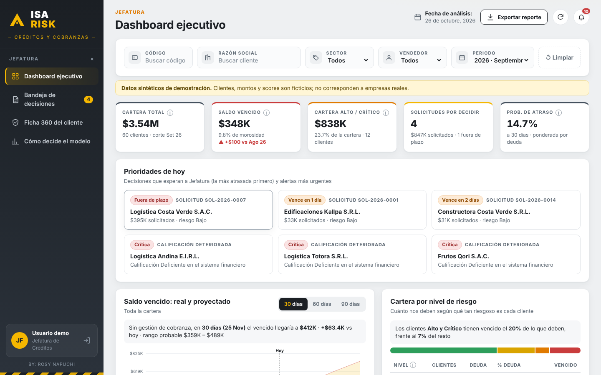
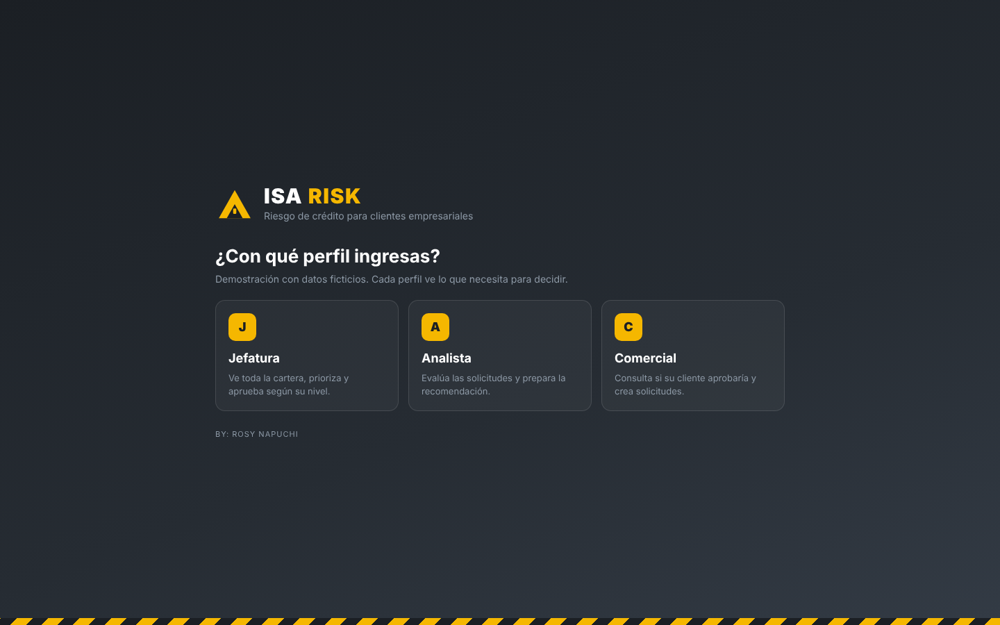
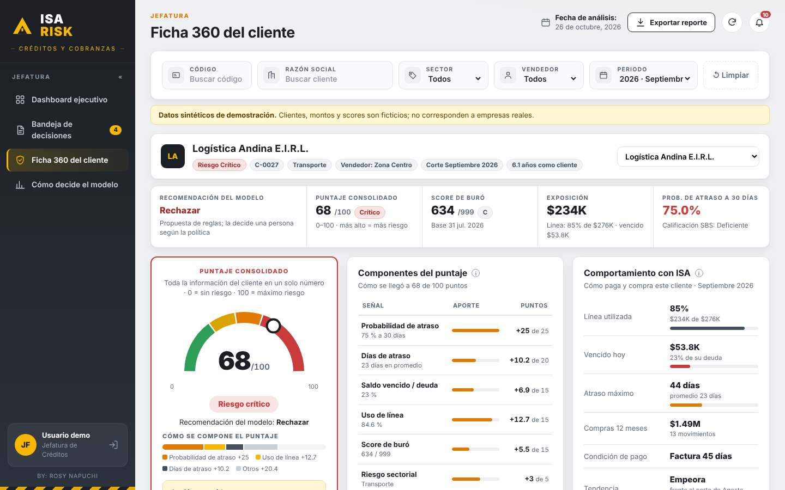
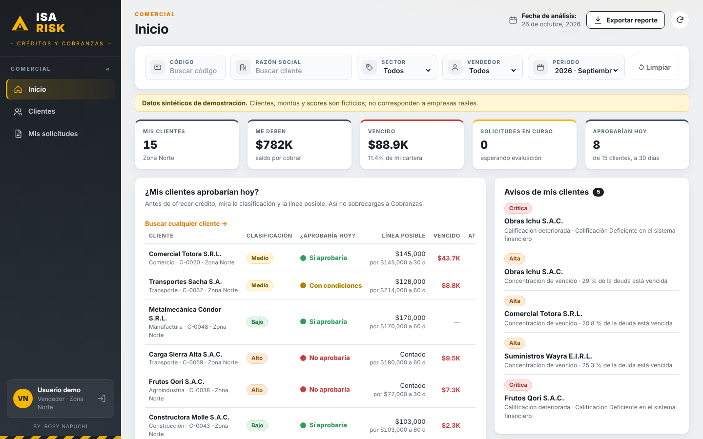

# ISA Risk

**Riesgo predictivo y recomendación de crédito para clientes empresariales (B2B).**

ISA Risk reúne en una sola aplicación la cartera por cobrar de un distribuidor industrial, el riesgo de cada cliente y la decisión de crédito. Para cada solicitud dice si **aprobar, aprobar con condiciones o rechazar**, **cuánta línea** dar, **a qué plazo** y **quién la debe aprobar**, con la probabilidad de atraso a **30, 60 o 90 días**.

> Todos los clientes, nombres, montos y scores son **ficticios**. Se generan con `tools/generar_datos.py` y no corresponden a ninguna empresa real.



## Cómo probarla

1. Descarga o clona el repositorio.
2. Abre `index.html` en cualquier navegador (Chrome, Edge, Firefox o Safari).
3. Elige un perfil: **Jefatura**, **Analista** o **Comercial**.

No necesita instalación, servidor, base de datos ni internet.

## Perfiles

| Perfil | Qué ve |
|---|---|
| **Jefatura** | Dashboard ejecutivo, Bandeja de decisiones, Ficha 360 del cliente y Cómo decide el modelo |
| **Analista** | Mi bandeja (evalúa las solicitudes), Ficha 360 del cliente y Cómo decide el modelo |
| **Comercial** | Inicio con "¿Mis clientes aprobarían hoy?", Clientes (puede consultar cualquier cliente) y Mis solicitudes |

El ingreso es de demostración, sin contraseña.



## Pantallas

### Dashboard ejecutivo
- Filtros por código, razón social, sector, vendedor y periodo.
- Indicadores: cartera total, saldo vencido, cartera alto/crítico, solicitudes por decidir y probabilidad de atraso.
- **Prioridades de hoy**: solicitudes fuera de plazo y alertas más urgentes.
- **Saldo vencido real y proyectado** a 30, 60 y 90 días, con escenario optimista y pesimista.
- Cartera por nivel de riesgo, clientes principales, antigüedad del vencido y exposición por sector.
- Exportar la cartera evaluada a CSV.

### Bandeja de decisiones
Solicitudes por estado (Por evaluar, Aprobada, Rechazada) con su riesgo, la recomendación del modelo, la línea sugerida, quién aprueba y el plazo de respuesta.

### Ficha 360 del cliente
- Franja con recomendación, puntaje consolidado, score de buró, exposición y probabilidad de atraso.
- **Puntaje consolidado** 0–100 con medidor, composición y acción sugerida.
- **Componentes del puntaje**: cuántos puntos aporta cada señal.
- **Comportamiento con ISA**: uso de línea, vencido, atraso máximo, compras, condición de pago, tendencia y antigüedad del vencido.
- **Riesgo predictivo** con selector 30/60/90 días: al cambiar el horizonte cambian la probabilidad, la decisión, la línea, el plazo y el aprobador.
- Evolución en el buró, alertas, solicitudes y documentos.



### Inicio del Comercial
Antes de ofrecer crédito, el vendedor ve la clasificación de sus clientes, si aprobarían hoy y la línea posible.

### Nueva solicitud (Comercial) y aprobación (Jefatura)
El Comercial registra una solicitud (cliente, monto, plazo, orden de compra y comentario) y, mientras la llena, ve lo que diría el modelo: decisión, línea posible y quién aprueba. Al enviarla, aparece en la bandeja de Analista y Jefatura, y Jefatura la aprueba o rechaza desde la Ficha 360. Las solicitudes de la demo se guardan en el navegador.



### Cómo decide el modelo
Todas las reglas explicadas en lenguaje simple, dentro de la aplicación.

## Cómo decide

1. **Probabilidad de atraso.** Regresión logística con pesos fijos y explicables sobre 7 datos: atraso promedio, atraso máximo, uso de la línea, antigüedad, calificación en el sistema financiero, deuda bancaria sobre ventas y documentos protestados. Un intercepto por horizonte (30, 60 y 90 días).
2. **Puntaje consolidado (0–100, más alto = más riesgo).** Suma 7 señales, cada una con tope:

   | Señal | Tope |
   |---|---|
   | Probabilidad de atraso | 25 |
   | Días de atraso | 20 |
   | Saldo vencido / deuda | 15 |
   | Uso de línea | 15 |
   | Score de buró | 15 |
   | Riesgo sectorial | 5 |
   | Tendencia del vencido | 5 |

   Niveles: **Bajo** (< 30), **Medio** (30–44), **Alto** (45–59) y **Crítico** (60 o más).
3. **Reglas de exclusión.** Calificación Dudoso o Pérdida rechaza. Protestos, atrasos de más de 90 días o más de 30 % de la deuda vencida impiden aprobar sin condiciones.
4. **Límites por horizonte.** Aprobar hasta 5 % de probabilidad a 30 días, 2,5 % a 60 y 1,2 % a 90: más exigente cuanto más largo el atraso.
5. **Línea sugerida.** El menor entre lo solicitado y la capacidad: compras del plazo × 1,5 de holgura × factor del nivel de riesgo, con tope del 10 % de las ventas anuales. Con condiciones, el plazo baja un escalón.
6. **Quién aprueba.** Analista de Créditos (hasta USD 25 000 y 30 días), Jefe de Créditos y Cobranzas (hasta USD 100 000 y 60 días), Gerencia de Finanzas (hasta USD 250 000 y 90 días) o Comité de Crédito. Manda el nivel más alto entre monto y plazo.

La recomendación es una propuesta: la decisión final la toma una persona según la política.

## Datos sintéticos

`tools/generar_datos.py` (Python, sin dependencias) crea 60 clientes de seis sectores a partir de un "riesgo latente", para que sus datos sean coherentes entre sí: quien suele pagar tarde también tiende a usar más su línea y a tener peor calificación. Incluye historia de 6 meses del vencido, vencido por antigüedad, tres bases de buró, 14 solicitudes de crédito y sus documentos. Usa una semilla fija, así que siempre genera la misma cartera.

Para regenerar los datos:

```
python tools/generar_datos.py
```

## Estructura

```
index.html              página y pantalla de ingreso
css/styles.css          estilos
js/modelo.js            probabilidad, puntaje consolidado, reglas de decisión y alertas
js/app.js               pantallas, perfiles, filtros y gráficos
data/clientes.js        cartera sintética (generada)
tools/generar_datos.py  generador de datos ficticios
docs/capturas/          capturas de pantalla
devpost/                planificación: scope.md, prd.md, spec.md
```

## Hecho para

*Build With AI: Basics* (Devpost, octubre 2026). Planificado y construido con el Devpost Learn Skill Pack: alcance, requisitos y plan técnico están en `devpost/`.

**BY: Rosy Napuchi**
